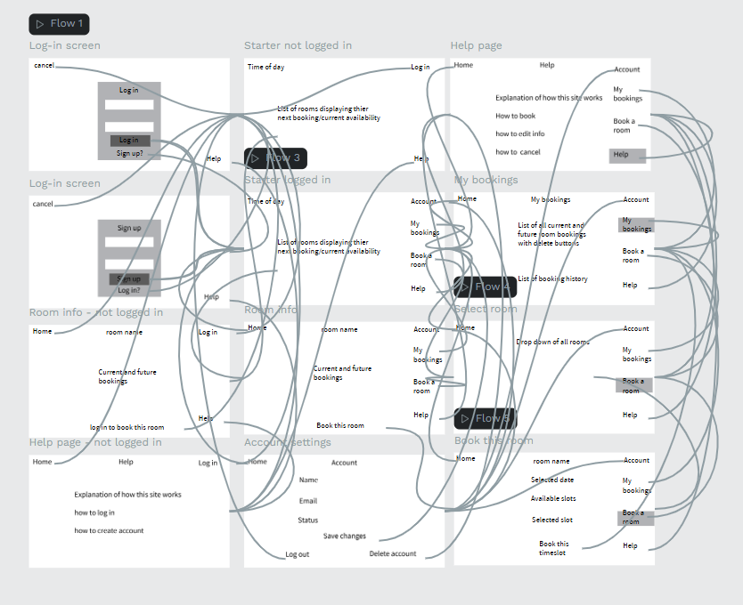
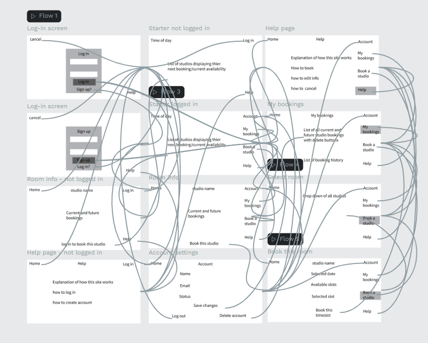
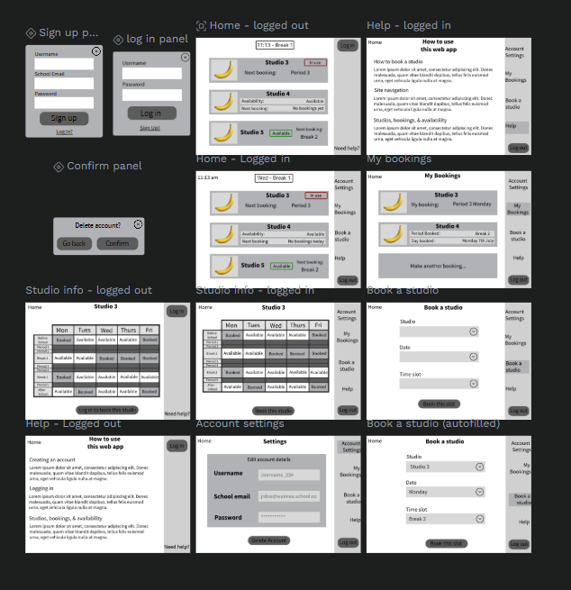

# Sprint 1 - Developing a DB and UI Prototype

## Sprint Goals

Develop a design for the database and a UI prototype that simulates the key functionality of the system. Test and refine the UI so that it can serve as the model for the next phase of development in Sprint 2.

### Specific Goals

**Edit these goals as needed**

- Design the database:
    - Tables
    - Fields / types
    - Primary keys
    - Default / nullable values
    - Relationships (foreign keys)
- Design the UI
    - Key pages
    - User interactions and 'flow'
    - Page layouts / features
    - Colour palette
    - Etc.

## Initial Database Design

Replace this text with notes regarding the DB design.

### Required Data Input

Replace this text with a description of what data will be input, and where / how it will be obtained.

### Required Data Output

Replace this text with a description of the outputs for the system - what types of data will be displayed?

### Required Data Processing

Replace this text with a description of how the data will be processed to achieve the desired output(s) - any processes / formulae?

## UI 'Flow'

The first stage of prototyping was to explore how the UI might 'flow' between states, based on the required functionality.

This Penpot demo shows the initial design for the UI 'flow':

https://design.penpot.app/#/view?file-id=f0485fb1-4e63-8165-8008-3908162e8168&page-id=f0485fb1-4e63-8165-8008-3908162e8169&section=interactions&index=0&share-id=6956fb43-d0b4-807f-8008-4224ada5fb9a

### Testing

To test this flow i sent it to my end users to test and give feedback on.

My first end user, the staff member, was happy with the flow of the ui and had no issues. She requested I replace the word room with studio for clarity.

My second end user, a music student, said "a way to access the individual room information through the 'My bookings' tab would be lovely."

My third end user, another music student, was satisfied with the flow, but requested that after a user logs in, the app redirects to the "My bookings" tab instead of the home screen.

### Changes / Improvements

Added requested features.

https://design.penpot.app/#/view?file-id=a1a9e568-e174-80fb-8008-5d1c38774a33&page-id=f0485fb1-4e63-8165-8008-3908162e8169&section=interactions&index=0&share-id=64054412-1123-81ed-8008-5d1cdea754d8

## Initial UI Prototype

The next stage of prototyping was to develop the layout for each screen of the UI.

This Penpot demo shows the initial layout design for the UI:

https://design.penpot.app/#/view?file-id=a1a9e568-e174-80fb-8008-5d1d16285281&page-id=a1a9e568-e174-80fb-8008-5d1d16285282&section=interactions&index=0&share-id=81f57451-85cc-819d-8008-7823d583471e

### Testing

I sent this ui prototype to my end users for feedback.

My first end user, the staff member, proposed the studios to be displayed in a grid of boxes, as opposed to rectangular bars. She also was unsure of the next booking display and requested options without it. she had no opinion on the my bookings section, saying she was happy with either display. She was otherwise happy with the design.

My second end user, a music student, said "On the home page, i think that the studio 5 design looks best, but I think that the studio 4 one looks better in the "My bookings" tab, so to keep it all consistant, I think that should be the choice. I also think that left alignment looks best for the menu. One other thing is that I think the home button should be with all the other buttons on the side menu, as it is kinda weird that all the buttons but that one is on the side. But looks pretty good otherwise"

### Changes / Improvements

I created a boxed grid display for the new version, with four options for their design.

https://design.penpot.app/#/view?file-id=c828d3cf-7d4e-8145-8008-934111a40059&page-id=a1a9e568-e174-80fb-8008-5d1d16285282&section=interactions&index=0&share-id=7caa4534-d91d-42bf-9f79-de77e403c936

### Testing

I sent this ui prototype to my end users for feedback.

My first end user, the staff member, preferred studio 4 option.

My second end user, a music student, preferred studio three, but had studio 4 as a close second favourite.

### Changes / Improvements

I went with the studio 4 option as it displays the image in a much larger area, making it more visible and less cluttered.

https://design.penpot.app/#/view?file-id=3be9e5e1-190f-8090-8008-7e8b1dade9b4&page-id=a1a9e568-e174-80fb-8008-5d1d16285282&section=interactions&index=0&share-id=502b4555-3f5f-807a-8008-8a3b4052c3e3

## Refined UI Prototype

Having established the layout of the UI screens, the prototype was refined visually, in terms of colour, fonts, etc.

This Figma demo shows the UI with refinements applied:

https://design.penpot.app/#/view?file-id=bfddaaba-4180-81d4-8008-db35f5af28c1&page-id=a1a9e568-e174-80fb-8008-5d1d16285282&section=interactions&index=0&share-id=2fff45cf-b464-45a0-b8bd-83b15b2f8d20

### Testing

My first end user, the staff member, liked the look of the colours and fonts, but pointed out to me that the labels on the make a booking site were no longer visible.

My second end user, a music student, liked the design, but suggested removing the borders on the images in the studio display.

### Changes / Improvements

I acted on the changes suggested by my end users.

https://design.penpot.app/#/view?file-id=61fd668e-ca9f-8100-8008-db395d6bedd9&page-id=a1a9e568-e174-80fb-8008-5d1d16285282&section=interactions&index=0&share-id=eec73663-d81f-4a75-bf37-1e40c5536ab1

## Sprint Review

Replace this text with a statement about how the sprint has moved the project forward - key success point, any things that didn't go so well, etc.

