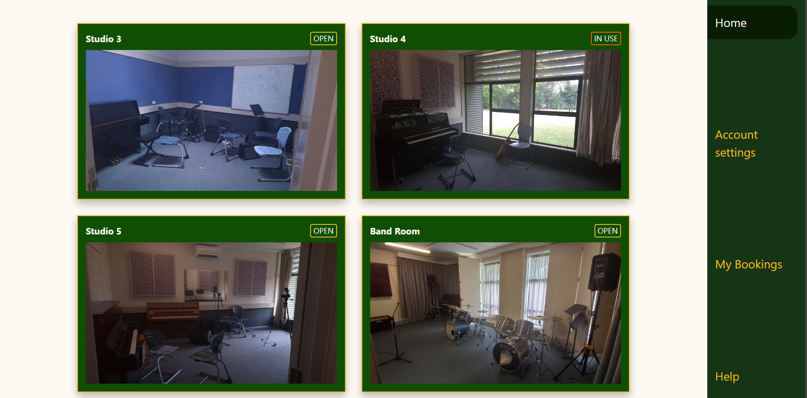
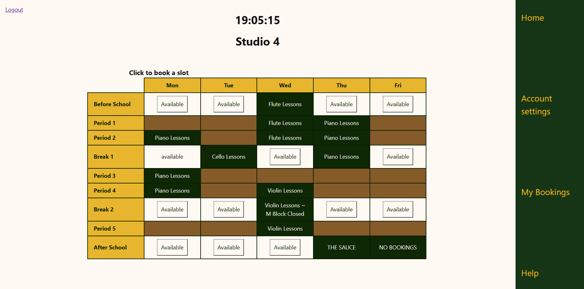
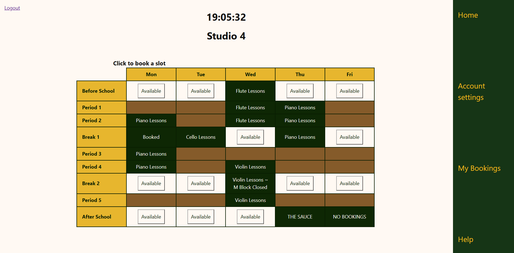

# Sprint 2 - Implement Database and Display of Test Data

## Sprint Goals

Implement the database, populated with test data. Create queries that retrieve test data, and display this on web pages as needed. Test and refine the queries and data display, so that it stands as the basis of the next sprint.

### Specific Goals

- Implement the database
- Add test data to the database
- Create the following web pages:
    - Home pages showing studios and their current availability
    - Studio page showing the days of the week and which days are booked
    - Bookings page showing each students booking (For admin)
- Develop SQL database queries to:
    - Retrieve all studios 
    - Retrieve specific studio along with bookings for that studio
    - Retrieve all bookings with the students email attatched to their booking

## Testing Home page

All studios should be displayed with the correct image file and show as unavailable when booked at the current moment 

### Changes / Improvements

works as expected.

## Testing Studio page

Timetable for the week should be displayed with bookings displayed

### Changes / Improvements

booked studios were not being displayed. This was a typo in the code which i fixed.

## Testing bookings page

student bookings are shown and all bookings can be cleared.

### Changes / Improvements

Redirecting for bookings felt clunky. changed it to be consistent.

## Sprint Review

The database is working well. My app is able to connect to the database and make queries & retrieve data. This gives me the basis of my site to build off and develop further functionality into the users and other systems related to the database.

