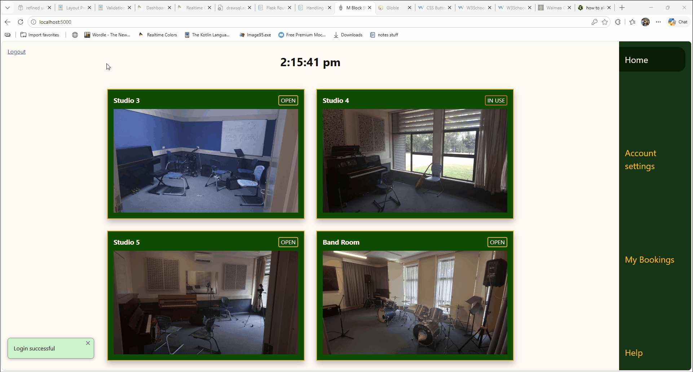
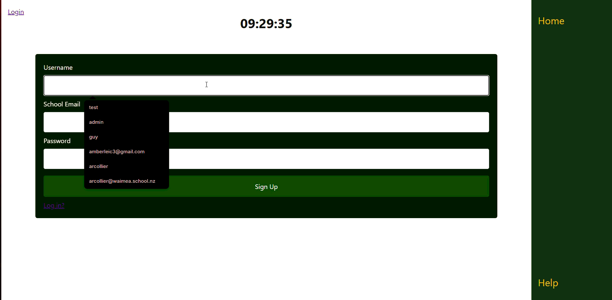
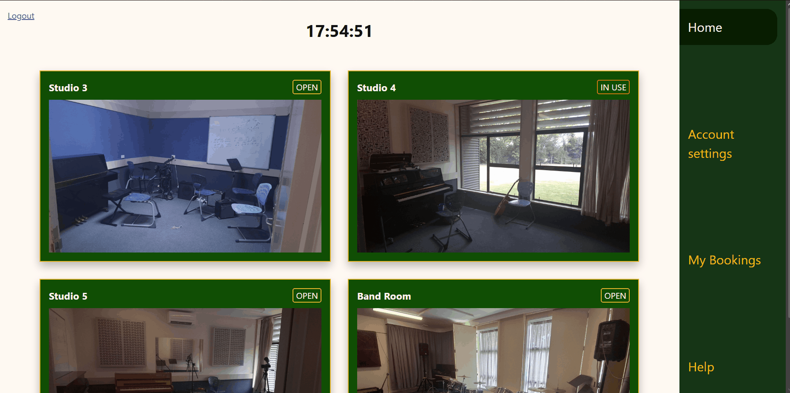
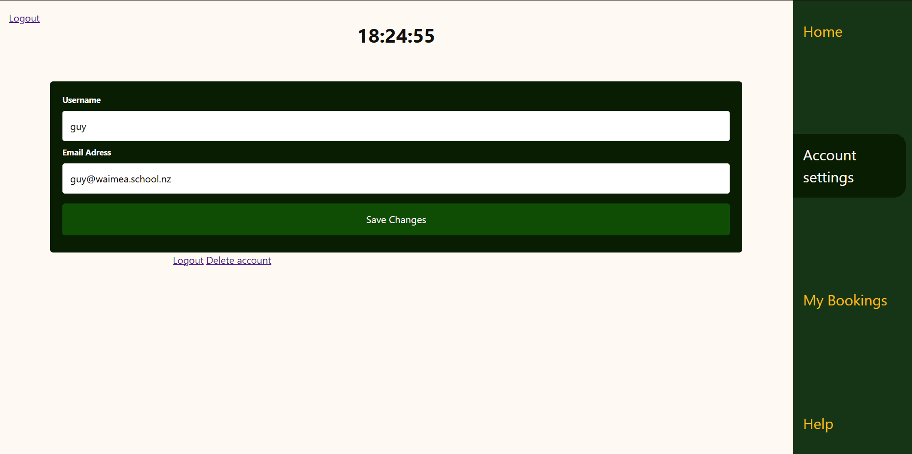
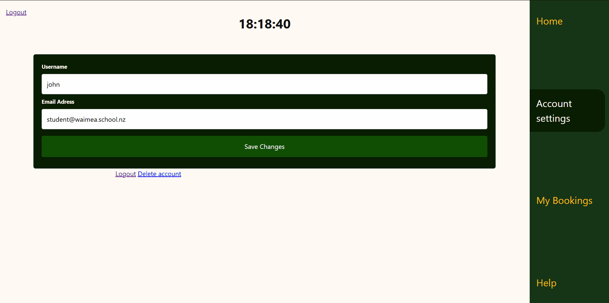

# Sprint 3 - Developing a Minimum Viable Product (MVP)

## Sprint Goals

Continue to develop the web application to the point that it provides all key functionality of the system. Test and refine it so that it can serve as the basis for the final phase of development.

### Specific Goals

**Edit these goals as needed**

- Create the following web pages:
    - Form for creating an account and logging in
    - Form to create a booking for the user
    - Allow users to edit their account info and delete their account
- Develop SQL database queries to:
    - Add a new user to the database
    - Create a new booking and ensure the user cannot book a staff only slot.
    - Edit an account and delete an account

## Testing logging in and signing up

Testing the log in page, ensuring it creates the account, allows valid logins, and rejects incorrect inputs such as wrong passwords, pre-existing usernames, and non-waimea emails

### Changes / Improvements

The log in process after signing in felt clunky and slow, so I changed it to automatically log you in after signing up.

## Testing creating new bookings

Create new bookings, ensure multiple bookings cannot be created. 

### Changes / Improvements

This worked great and no improvements were needed.

## Testing editing account information

Test editing the account, editing the email, and deleting an account. Information should update and account should be fully deleted.

### Changes / Improvements

Deleting the account and preventing changing the email to a non waimea address worked well. There was an issue with the display though, as the edits would be made in the database but the session would not update. 

## Sprint Review

This sprint has identified key usability issues and improved the overall feel of the website.

