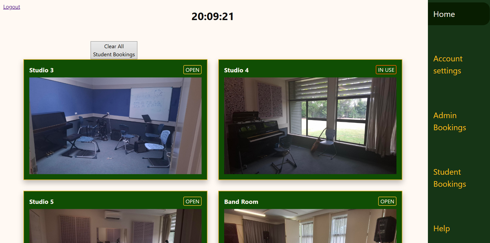
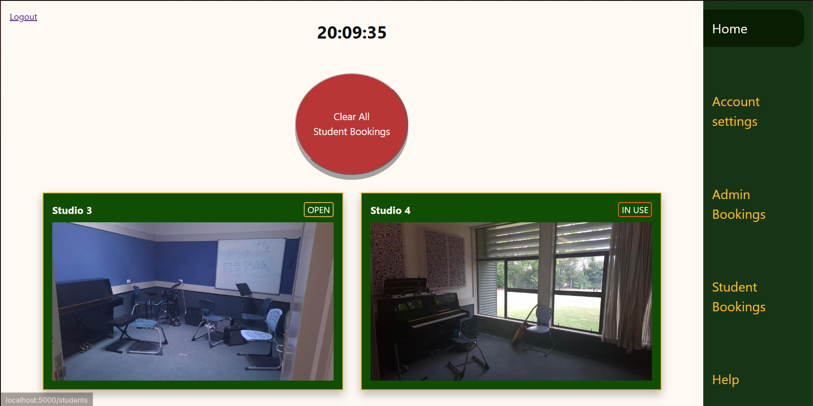
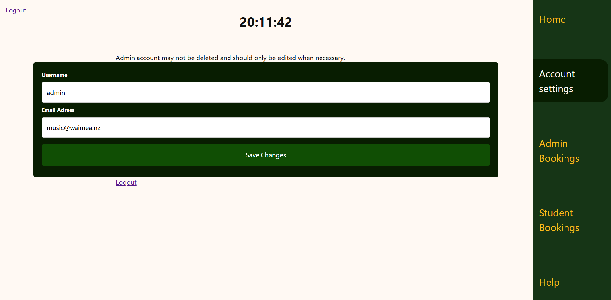
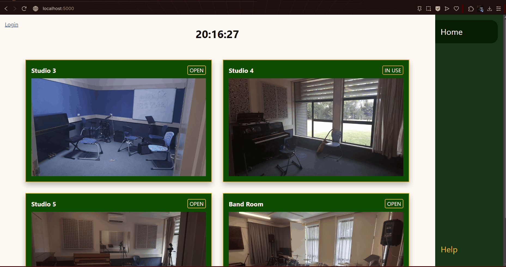

# Sprint 4 - Developing a Refined and Complete System

## Sprint Goals

Develop the system until it is fully featured, with a refined UI and it satisfies the requirements. The system will be fully tested at this point.

### Specific Goals

**Edit these goals as needed**

- Refine the design and UI of the website
- Refine the user experience (UX) of the system
- Perform final, full-system testing

## Adding colours

I added colours that aligned with my original design.

### Changes / Improvements

The clear all button was a new addition, so i improvised some styling for it to keep it from being plain.

## Formatting

I added basic formatting to my forms.

### Changes / Improvements

all looks fine

## Testing blocked access

Logged out users cannot acess log in exclusive pages, and students cannot acess admin pages.

### Changes / Improvements

redirect failed, edited typos to fix.

## Sprint Review

Replace this text with a statement about how the sprint has moved the project forward - key success point, any things that didn't go so well, etc.

